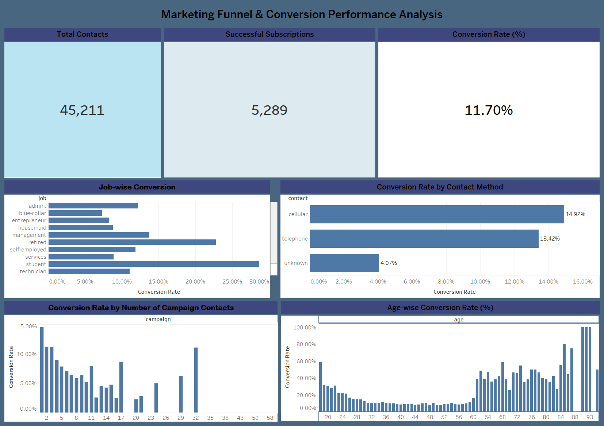

# 📊 Marketing Funnel & Conversion Performance Analysis

### Future Interns – Data Science & Analytics Internship | Task 3

Analyzing customer conversion patterns, marketing campaign performance, and opportunities to improve lead-to-customer conversion using Tableau.

---

## 📌 Project Overview

This project focuses on analyzing marketing funnel performance using the Bank Marketing dataset.

The objective is to understand how customers respond to marketing campaigns, identify conversion patterns, evaluate contact methods, and discover opportunities to improve marketing effectiveness.

An interactive dashboard was developed in **Tableau Desktop** to present key performance indicators and visual insights.

---

## 🎯 Project Objectives

- Analyze overall marketing funnel conversion performance.
- Identify conversion patterns across different job categories.
- Compare conversion rates by contact method.
- Evaluate the relationship between campaign contacts and successful subscriptions.
- Analyze age-wise conversion patterns.
- Identify opportunities to improve marketing campaign effectiveness.

---

## 🛠️ Tools & Technologies

- **Tableau Desktop** – Data analysis, calculated fields, KPI creation, data visualization, and dashboard development.
- **CSV Dataset** – Bank Marketing dataset used for analysis.

---

## 📂 Dataset

The project uses the Bank Marketing dataset containing customer information and marketing campaign details.

**Dataset Source:** Kaggle – Bank Marketing Dataset

[Download Dataset](https://www.kaggle.com/datasets/adityamhaske/bank-marketing-dataset)

**Working Dataset:** `bank-full-clean.csv`

The dataset includes information such as:

- Age
- Job
- Marital Status
- Education
- Contact Method
- Campaign Contacts
- Previous Marketing Campaign Information
- Subscription Outcome

The target variable `y` indicates whether a customer subscribed to the offered term deposit.

---

## 📈 Key Performance Indicators (KPIs)

The dashboard highlights the following KPIs:

| KPI | Value |
|---|---:|
| Total Contacts | 45,211 |
| Successful Subscriptions | 5,289 |
| Overall Conversion Rate | 11.70% |

**Overall Conversion Rate Formula:**

Successful Subscriptions ÷ Total Contacts × 100

---

## 📊 Dashboard Preview



### Tableau Workbook

[📥 Download Tableau Packaged Workbook (.twbx)](Marketing_Funnel_Conversion_Analysis.twbx)

### Dataset

[📥 Download Bank Marketing Dataset](bank-full-clean.csv)

---

## 📉 Dashboard Visualizations

The dashboard contains four major analytical visualizations:

### 1. Job-wise Conversion

Analyzes how conversion performance varies across different job categories and helps identify customer segments with stronger subscription responses.

### 2. Conversion Rate by Contact Method

Compares conversion rates across different contact methods to understand which communication channels perform better.

### 3. Conversion Rate by Number of Campaign Contacts

Examines how conversion rates vary with the number of campaign contacts and helps evaluate campaign contact effectiveness.

### 4. Age-wise Conversion Rate

Analyzes conversion patterns across different age groups to understand how customer age relates to subscription decisions.

---

## 💡 Key Business Insights

- The overall conversion rate is approximately **11.70%**, indicating that only a portion of contacted customers subscribed.
- Conversion performance varies across job categories, highlighting the importance of customer segmentation.
- Comparing contact methods can help identify more effective communication channels.
- Campaign contact frequency should be evaluated to avoid unnecessary repeated customer interactions.
- Age-wise conversion analysis can help businesses understand differences in customer responses across age groups.

---

## 🚀 Business Recommendations

1. **Improve Customer Targeting:** Focus marketing efforts on customer segments showing stronger conversion potential.
2. **Optimize Contact Methods:** Prioritize communication channels that demonstrate better conversion performance.
3. **Optimize Campaign Frequency:** Avoid excessive repeated contacts and improve campaign efficiency.
4. **Use Customer Segmentation:** Develop targeted marketing strategies based on customer characteristics.
5. **Monitor Conversion KPIs:** Regularly track conversion rates and campaign performance to support data-driven decisions.

---

## 📁 Project Structure

```text
FUTURE_DS_03/
│
├── README.md
├── bank-full-clean.csv
├── Marketing_Funnel_Conversion_Analysis.twbx
└── Marketing_Funnel_Dashboard.png
```

---

## 📌 Project Deliverables

- Cleaned Bank Marketing dataset
- Tableau packaged workbook (`.twbx`)
- Marketing Funnel Dashboard (PNG)
- Project documentation (README)

---

## 🏁 Conclusion

This project demonstrates how marketing campaign data can be transformed into meaningful business insights using Tableau Desktop.

The dashboard provides an overview of marketing funnel performance, customer conversion patterns, and campaign effectiveness.

These insights can help businesses make informed decisions, improve customer targeting, optimize campaign strategies, and enhance overall marketing performance.

---

## 👤 Author

**Simran Bhasin**

Aspiring Data Analyst | Data Science & Analytics Enthusiast

[](https://www.linkedin.com/in/simranbhasin310/)

[](https://github.com/simranbhasin310/)

[](mailto:simranbhasin310@gmail.com)

[](https://github.com/simranbhasin310/SimranBhasin310.github.io)

---

⭐ If you found this project useful, feel free to star this repository!

**Thank you for visiting my project!**

